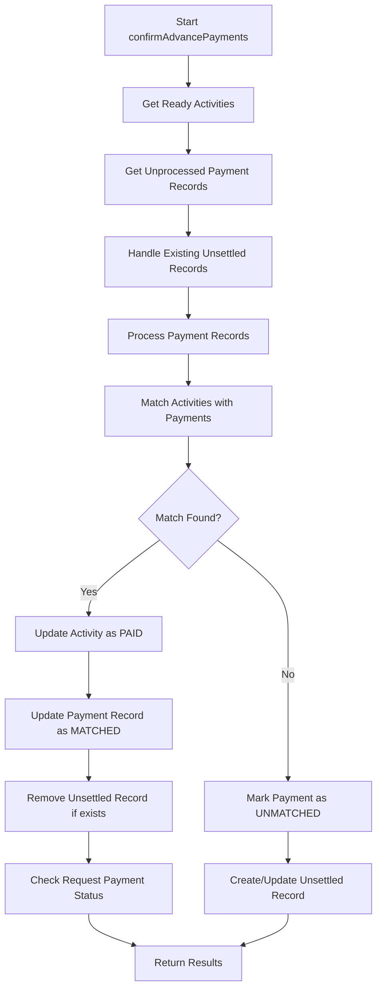
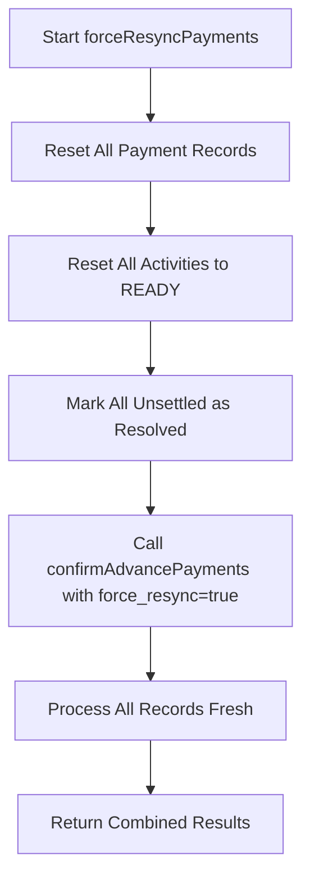
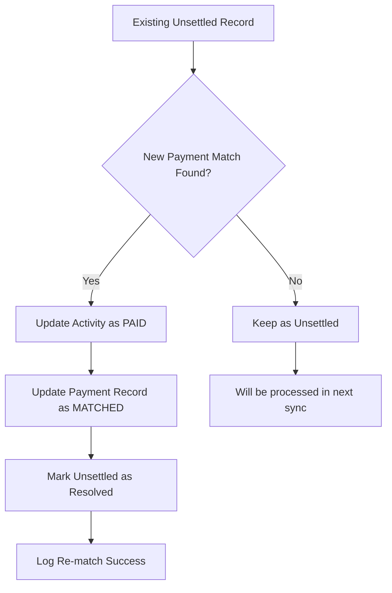

# Enhanced Payment Confirmation System

## Overview
The enhanced payment confirmation system provides comprehensive handling of payment matching between `digi_next_payment_file` records and advance request activities, with support for re-syncing, unsettled payment management, and automatic resolution of timing mismatches.

## Key Features

### 1. **Enhanced Payment Confirmation** (`confirmAdvancePayments`)
- ✅ **Comprehensive `digi_next_payment_file` Updates**: Updates all relevant fields when payments are matched
- ✅ **Unsettled Payment Handling**: Automatically manages unsettled records with resolution tracking
- ✅ **Re-sync Support**: Optional `force_resync` parameter for re-processing previously processed records
- ✅ **Timing Mismatch Resolution**: Handles cases where payments arrive at different times than activities

### 2. **Force Re-sync Functionality** (`forceResyncPayments`)
- ✅ **Complete Reset**: Resets all payment records and activities for fresh matching
- ✅ **Automatic Re-processing**: Automatically calls `confirmAdvancePayments` after reset
- ✅ **Comprehensive Logging**: Detailed logging of reset operations

### 3. **Intelligent Unsettled Management**
- ✅ **Automatic Resolution**: Previously unsettled records are automatically resolved when matches are found
- ✅ **Status Tracking**: Tracks 'Unsettled' and 'Resolved' statuses
- ✅ **Duplicate Prevention**: Enhanced duplicate prevention with database locking

## API Endpoints

### 1. Enhanced Payment Confirmation
```http
POST /api/advance/finance/confirm-payments
```

**Parameters:**
- `force_resync` (optional, boolean): Re-process previously processed records

**Enhanced Response:**
```json
{
  "success": true,
  "message": "Payment confirmation sync processed successfully",
  "data": {
    "total_payment_records": 50,
    "processed_payment_records": 45,
    "total_advance_requests": 40,
    "matched_payments": 35,
    "re_matched_payments": 5,
    "unsettled_requests": 5,
    "success_rate": 87.5,
    "payment_match_rate": 77.8,
    "force_resync_enabled": false,
    "errors": []
  }
}
```

### 2. Force Re-sync Payments
```http
POST /api/advance/finance/force-resync-payments
```

**Response:**
```json
{
  "success": true,
  "message": "Payment confirmation sync processed successfully",
  "data": {
    "total_payment_records": 50,
    "processed_payment_records": 50,
    "matched_payments": 40,
    "re_matched_payments": 0,
    "unsettled_requests": 10,
    "force_resync_enabled": true
  }
}
```

### 3. Enhanced Unsettled Payments
```http
GET /api/advance/finance/unsettled-payments?status=Unsettled&include_resolved=true
```

**Parameters:**
- `status` (optional): Filter by status ('Unsettled' or 'Resolved')
- `include_resolved` (optional, boolean): Include resolved records

**Enhanced Response:**
```json
{
  "success": true,
  "data": {
    "unsettled_payments": [...],
    "total_count": 15,
    "unsettled_count": 10,
    "resolved_count": 5,
    "status_filter": "Unsettled",
    "include_resolved": true
  }
}
```

## Database Updates

### 1. `digi_next_payment_file` Table Updates
When payments are confirmed, the following fields are updated:

```sql
UPDATE digi_next_payment_file SET
  is_processed = 1,
  matched_activity_id = {activity_id},
  processed_at = NOW(),
  processed_by = {user_id},
  match_status = 'MATCHED',
  match_remarks = 'Matched with activity ID {activity_id} - Employee: {employee_name} - Amount: {amount}'
WHERE id = {payment_record_id};
```

### 2. `advance_request_activities` Table Updates
When activities are confirmed as paid:

```sql
UPDATE advance_request_activities SET
  payment_status = 'Paid',
  payment_amount = {amount},
  payment_date = {value_date},
  payment_remark = 'Payment confirmed via sync - Ref: {transaction_refno} - UTR: {utr_reference}'
WHERE id = {activity_id};
```

### 3. `unsettled_payments` Table Management
- **New Unsettled Records**: Created with status 'Unsettled'
- **Resolved Records**: Updated to status 'Resolved' when matches are found
- **Duplicate Prevention**: Enhanced with database locking

## Enhanced Workflow

### 1. **Normal Payment Confirmation Flow**


### 2. **Force Re-sync Flow**


### 3. **Unsettled Record Handling**


## Key Enhancements

### 1. **Comprehensive Payment Record Updates**
```php
// Enhanced payment record update with detailed match information
$paymentRecord->update([
    'is_processed' => true,
    'matched_activity_id' => $bestMatch->id,
    'processed_at' => now(),
    'processed_by' => $userId,
    'match_status' => 'MATCHED',
    'match_remarks' => "Matched with activity ID {$bestMatch->id} - Employee: {$employeeName} - Amount: {$amount}"
]);
```

### 2. **Enhanced Activity Updates**
```php
// Enhanced activity update with UTR reference
$activity->update([
    'payment_status' => AdvanceRequestActivity::PAYMENT_STATUS_PAID,
    'payment_amount' => $amount,
    'payment_date' => $paymentRecord->value_date ?? now()->toDateString(),
    'payment_remark' => "Payment confirmed via sync - Ref: {$transactionRef} - UTR: {$paymentRecord->rbi_utr_reference_number}"
]);
```

### 3. **Intelligent Unsettled Resolution**
```php
// Automatic resolution of previously unsettled records
private function handleExistingUnsettledRecords($readyActivities, $paymentRecords, $userId, &$matchedActivityIds, &$reMatchedPayments)
{
    // Find existing unsettled records for ready activities
    // Try to match them with available payment records
    // Resolve unsettled records when matches are found
    // Track re-matched payments for reporting
}
```

## Testing Scenarios

### 1. **Normal Payment Confirmation**
```bash
# Test normal payment confirmation
curl -X POST /api/advance/finance/confirm-payments \
  -H "Content-Type: application/json" \
  -d '{"user_id": 123}'
```

### 2. **Force Re-sync Testing**
```bash
# Test force re-sync functionality
curl -X POST /api/advance/finance/force-resync-payments \
  -H "Content-Type: application/json" \
  -d '{"user_id": 123}'
```

### 3. **Timing Mismatch Resolution**
```bash
# 1. First sync - some payments not yet available
curl -X POST /api/advance/finance/confirm-payments

# 2. Later sync - new payments available, should resolve unsettled
curl -X POST /api/advance/finance/confirm-payments

# 3. Check unsettled payments - should show resolved records
curl -X GET /api/advance/finance/unsettled-payments?include_resolved=true
```

### 4. **Duplicate Prevention Testing**
```bash
# Multiple rapid calls should not create duplicates
for i in {1..5}; do
  curl -X POST /api/advance/finance/confirm-payments &
done
wait

# Check for duplicates
curl -X GET /api/advance/finance/unsettled-payments
```

## Monitoring and Logging

### 1. **Enhanced Logging**
- Payment matching operations
- Re-sync operations
- Unsettled record resolution
- Duplicate prevention actions
- Error conditions and recovery

### 2. **Key Metrics to Monitor**
- **Match Rate**: Percentage of successful payment matches
- **Re-match Rate**: Percentage of previously unsettled records resolved
- **Processing Time**: Time taken for payment confirmation operations
- **Error Rate**: Frequency of processing errors
- **Duplicate Prevention**: Number of duplicate attempts prevented

### 3. **Log Examples**
```
[INFO] Payment matched: Activity 123 with Payment Record 456 - Amount: 5000.00
[INFO] Re-matched unsettled payment: Activity 789 with Payment Record 101 - Amount: 3000.00
[INFO] Removed unsettled record for activity 123: Payment confirmed - Ref: TXN123456
[INFO] Force re-sync initiated: Reset 50 payment records, 45 activities, 10 unsettled records
```

## Benefits

### 1. **Improved Accuracy**
- ✅ Comprehensive payment record tracking
- ✅ Automatic resolution of timing mismatches
- ✅ Enhanced duplicate prevention

### 2. **Better User Experience**
- ✅ Force re-sync capability for manual intervention
- ✅ Detailed status tracking and reporting
- ✅ Automatic cleanup of resolved records

### 3. **Operational Efficiency**
- ✅ Reduced manual intervention required
- ✅ Automatic handling of common edge cases
- ✅ Comprehensive audit trail

### 4. **Data Integrity**
- ✅ Consistent state management across tables
- ✅ Transaction safety with rollback capability
- ✅ Comprehensive error handling and recovery

## Migration Notes

### 1. **Backward Compatibility**
- All existing functionality preserved
- New features are additive
- Optional parameters maintain compatibility

### 2. **Database Changes**
- No schema changes required
- Uses existing table structures
- Enhanced data population only

### 3. **Deployment Considerations**
- Test force re-sync in staging environment
- Monitor initial performance impact
- Verify logging configuration
- Check database transaction performance