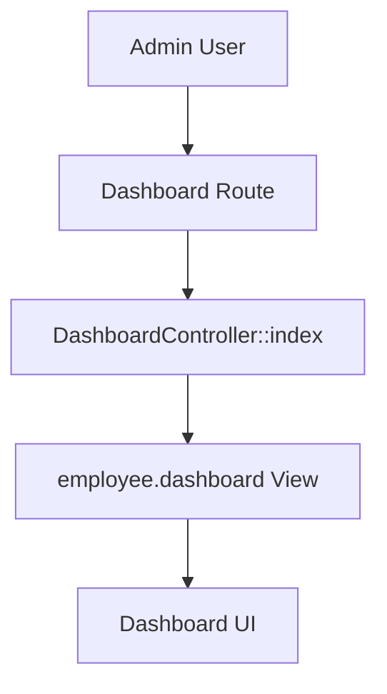

# 📊 Admin DashboardController Documentation

The Admin DashboardController provides the main dashboard interface for administrative users in the Xeasy Laravel expense management system.

## 📋 Overview

**Location**: `app/Http/Controllers/admin/DashboardController.php`

**Purpose**: Serves as the entry point for administrative users, providing access to the main dashboard interface.

**Middleware**: Inherits from base Controller (typically includes auth middleware)

**Key Features**:
- Simple dashboard view rendering
- Administrative interface access point
- Employee dashboard integration

## 📊 Public Methods

### 1. Dashboard Index

#### `index(): View`

**Route**: `GET /admin/dashboard` (typical route)
**Permission**: Admin access required

**Purpose**: Renders the main administrative dashboard interface.

**Parameters**: None

**Return Type**: `Illuminate\View\View`

**View Template**: `employee.dashboard`

**Implementation**:
```php
public function index()
{
    return view('employee.dashboard');
}
```

## 🔧 Implementation Details

### View Rendering

The controller uses a simple view rendering approach:

```php
return view('employee.dashboard');
```

**Features**:
- **Direct View Return**: No complex data processing
- **Template Location**: `resources/views/employee/dashboard.blade.php`
- **Minimal Logic**: Focuses on presentation layer

### Architecture Pattern

This controller follows the **Simple View Controller** pattern:
- **Single Responsibility**: Only handles dashboard view rendering
- **No Business Logic**: Delegates complex operations to other controllers
- **Clean Separation**: View logic separated from business logic

## 🎯 Dashboard Integration

### Expected Dashboard Components

The `employee.dashboard` view likely includes:

1. **Summary Widgets**:
   - Expense submission statistics
   - Pending approvals count
   - Recent activity feed
   - Compliance metrics

2. **Quick Actions**:
   - Submit new expense
   - View pending claims
   - Generate reports
   - Access settings

3. **Navigation Elements**:
   - Main menu integration
   - User profile access
   - Notification center
   - Search functionality

### Data Flow



## 🚀 Enhancement Opportunities

### Current Limitations

1. **No Data Passing**: Controller doesn't pass any data to the view
2. **Static Content**: Dashboard content is entirely view-dependent
3. **No Personalization**: No user-specific customization

### Recommended Improvements

#### 1. Data Integration

```php
public function index()
{
    $dashboardData = [
        'pending_expenses' => $this->getPendingExpensesCount(),
        'recent_submissions' => $this->getRecentSubmissions(),
        'compliance_stats' => $this->getComplianceStatistics(),
        'user_notifications' => $this->getUserNotifications(),
    ];

    return view('employee.dashboard', $dashboardData);
}
```

#### 2. User Personalization

```php
public function index()
{
    $user = auth()->user();
    $preferences = $user->dashboardPreferences ?? [];
    
    $dashboardData = [
        'widgets' => $this->getEnabledWidgets($preferences),
        'layout' => $preferences['layout'] ?? 'default',
        'theme' => $preferences['theme'] ?? 'light',
    ];

    return view('employee.dashboard', $dashboardData);
}
```

#### 3. Performance Optimization

```php
public function index()
{
    $cacheKey = 'dashboard_data_' . auth()->id();
    
    $dashboardData = Cache::remember($cacheKey, 300, function () {
        return [
            'summary_stats' => $this->getSummaryStatistics(),
            'recent_activity' => $this->getRecentActivity(),
            'alerts' => $this->getSystemAlerts(),
        ];
    });

    return view('employee.dashboard', $dashboardData);
}
```

## 🔐 Security Considerations

### Access Control

Ensure proper middleware protection:

```php
public function __construct()
{
    $this->middleware(['auth', 'permission:admin_dashboard']);
}
```

### Data Security

When implementing data passing:
- **Sanitize Output**: Ensure all data is properly escaped in views
- **Permission Checks**: Verify user permissions for displayed data
- **Sensitive Information**: Avoid exposing sensitive data in dashboard

## 📈 Monitoring and Analytics

### Metrics to Track

1. **Usage Analytics**:
   - Dashboard page views
   - Time spent on dashboard
   - Most accessed widgets
   - User interaction patterns

2. **Performance Metrics**:
   - Page load times
   - Widget rendering performance
   - Cache hit rates
   - Database query counts

### Logging Recommendations

```php
public function index()
{
    Log::info('Admin dashboard accessed', [
        'user_id' => auth()->id(),
        'timestamp' => now(),
        'ip_address' => request()->ip(),
    ]);

    return view('employee.dashboard');
}
```

## 🔄 Future Enhancements

### Suggested Features

1. **Widget System**:
   - Configurable dashboard widgets
   - Drag-and-drop interface
   - Custom widget creation
   - Widget marketplace

2. **Real-time Updates**:
   - WebSocket integration
   - Live notifications
   - Real-time statistics
   - Auto-refresh capabilities

3. **Advanced Analytics**:
   - Interactive charts
   - Trend analysis
   - Predictive insights
   - Export capabilities

4. **Mobile Optimization**:
   - Responsive design
   - Mobile-specific widgets
   - Touch-friendly interface
   - Progressive Web App features

### API Integration

Consider adding API endpoints for dashboard data:

```php
// API routes for dashboard widgets
Route::get('/api/dashboard/stats', [DashboardController::class, 'getStats']);
Route::get('/api/dashboard/recent', [DashboardController::class, 'getRecent']);
Route::get('/api/dashboard/alerts', [DashboardController::class, 'getAlerts']);
```

## 🔗 Related Components

### View Files
- `resources/views/employee/dashboard.blade.php` - Main dashboard template
- `resources/views/layouts/admin.blade.php` - Admin layout template
- `resources/views/components/widgets/` - Dashboard widget components

### Related Controllers
- `HomeController` - Main application entry point
- `ReportController` - Dashboard reporting integration
- `NotificationController` - Dashboard notifications
- `SettingController` - Dashboard configuration

### Frontend Assets
- Dashboard CSS styles
- JavaScript for interactive elements
- Chart libraries for data visualization
- Icon sets for UI elements

### Database Tables
- `users` - User authentication and preferences
- `dashboard_preferences` - User dashboard customization
- `notifications` - Dashboard notification system
- Various expense tables for dashboard statistics

---

The Admin DashboardController serves as a simple but essential entry point for administrative users, with significant potential for enhancement through data integration, personalization, and advanced features.